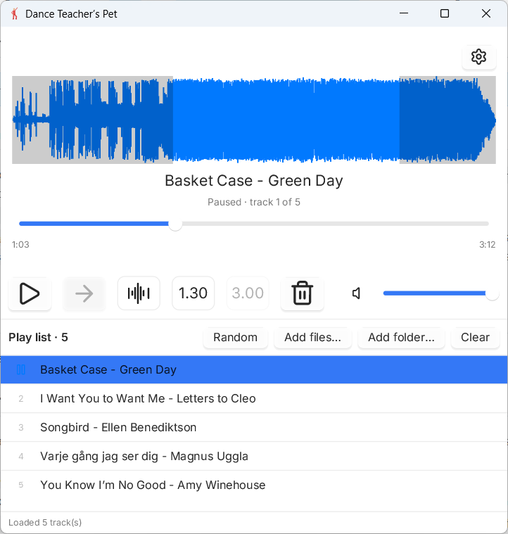

# Dance Teacher’s Pet

Dance Teacher’s Pet is a small, dependency-light audio player for Windows, written end to end in Zig, with a native-looking UI and no runtime to install.



Download: [latest release](../../releases/latest) (`DanceTeachersPet-windows-x64.zip`: a single `DanceTeachersPet.exe`, SDL3 is built in). Unzip and run `DanceTeachersPet.exe`.

## Why it exists

I teach dance courses, and I needed a music player that I could trust in the classroom. Three things mattered:

* **It has to work offline.** I don't know if there will be internet where I teach, so streaming services are out. The player works with local MP3 and FLAC files (and WAV), and needs nothing but the files on the computer.
* **The music must run for exactly as long as the exercise.** I pick the length of the exercise (1.30 or 3.00 minutes), start it, and the player stops by itself when the time is up. I never have to turn the music off myself, so I can keep my attention on the class.
* **Every song must sound equally loud.** When songs come from different sources, the volume jumps from track to track. Here all tracks are normalized to the same perceived loudness, so I don't have to reach for the volume control between songs while I'm teaching.

No existing player gave me all three, so I built Dance Teacher’s Pet: a simple player made for dance instructors like me.

## What it does

Plays MP3, FLAC and WAV files in a single window. The window shows the current track (title, track N of M, elapsed/total time) with a loudness graph that doubles as a draggable seek slider, play/pause, a continuous-playback toggle, a skip-silence toggle, two "dancer" buttons (1.30 and 3.00), a remove-played-tracks toggle, a volume slider and the play list. Add files or folders from the window or on the command line (`DanceTeachersPet [file-or-folder ...]`), click a track to play it, and shuffle or clear the list.

It is also a working example of combining [zigui](https://github.com/ddalcu/zigui) (UI), [dr_libs](https://github.com/mackron/dr_libs) (decoding) and [zoto](https://github.com/braheezy/zoto) (audio output) in one program.

## Getting started

### Requirements

* Windows (playback uses WASAPI; no other platform is supported)
* To run: nothing beyond the release zip
* To build from source:
  * **Zig 0.17.0**
  * Nothing else: SDL3 is fetched as source and compiled statically into the exe

No accounts, API keys or external services are needed.

### Installation

```sh
git clone https://github.com/LovaStr/Dance-Teacher-s-Pet
cd Dance-Teacher-s-Pet
```

Dependencies (zigui, dr_libs, SDL3) are pinned with hashes in `build.zig.zon`, so the first `zig build` fetches them.

### Configuration

There is no `.env` file. Configuration is done with build options:

| Option | Meaning |
|---|---|
| `-Doptimize=ReleaseFast` | Recommended for the UI |
| `-Dconsole=true` | Keep a console window for logs and errors (off by default) |
| `-Dtarget=x86_64-windows-gnu` | Cross-compile from another OS (what CI does) |

### Run

```sh
zig build -Doptimize=ReleaseFast
```

`DanceTeachersPet.exe` ends up in `zig-out\bin`; it needs no other files. To build and start the player in one step:

```sh
zig build run -- "C:\Users\you\Music"
```

`zig build test` runs the unit tests; they need neither SDL3 nor a window.

## Using the player

* Click a track in the play list to play it.
* **Play/pause** button: pause and resume.
* **Arrow** button: full strength = continue with the next track when one ends; dimmed = stop after the current track (the next track is cued, press play to start it).
* **Trim** button (waveform with cut marks): full strength = the silence at the start and end of a track is skipped; dimmed = the whole track plays. The silence threshold is set in the settings panel.
* **1.30** / **3.00** buttons (dancer mode): play only the loudest 90 s / 180 s of a track, faded in and out (fade length is in the settings panel). At most one is active; pressing the active one turns it off, and the other turns it on instead. 1.30 is on at start.
* **Trash** button: full strength = played tracks are removed from the list; dimmed = they stay.
* The loudness graph is the seek slider: click or drag it to jump to another time in the song. Parts that will not play (skipped silence, outside the dancer window) are shown dimmed; dragging into them starts 5 s before the end of the part that plays.
* Adding files to an empty list selects the first track and shows its graph (paused). When a track ends with continuous playback off, the next track is loaded the same way.
* **Random** shuffles the play list, stops any current playback and cues the first track of the new order; press play to start it.
* **Add files…** / **Add folder…** add audio files (a folder adds the supported files in it). **Clear** empties the play list.
* **Volume** slider on the right.
* Errors (unreadable files, a missing audio device, a failed seek) show in the status bar instead of crashing the player.

### Settings panel

The gear button opens the settings panel:

* **Scale** (dB or linear) and **Show** (peak, RMS or both) control how the loudness graph is drawn.
* **Silence below** (−80 to −20 dB, 1 s average) sets the threshold used by the Trim button.
* **Fade in / out** (0 to 5 s) sets the fade length in dancer mode.
* **Loudness normalization** on/off, with a **target loudness** (−24 to −7 LUFS) that every track is adjusted to, so all songs sound equally loud. A **limiter** (0 to 12 dB of gain reduction) keeps loud tracks from clipping when they are raised to the target.

### Keyboard shortcuts

| Key | Action |
|---|---|
| **Space** or any **letter** | Play/pause, same as the play/pause button |
| **Up** / **Left** | Select the row above the current track (nothing happens if there is none) |
| **Down** / **Right** | Select the row below the current track (nothing happens if there is none) |
| **Delete** | Stop the music and remove the current track from the play list; the next row is cued |

The arrow keys only start the new track if music was already playing; otherwise the row is loaded paused and you press play. Combinations with Ctrl, Alt or the Windows key are not treated as shortcuts.

Defaults at start: volume 100 %, continuous playback off, skip silence on (−34 dB), dancer 1.30 on, fade 2 s, loudness normalization on (−10 LUFS, limiter 6 dB), remove played tracks on.

## Architecture

Three layers with one direction of dependency: `decoder.zig` turns a file into PCM, `audio.zig` feeds that PCM to the zoto player, and `main.zig` holds the application state and the zigui views. The UI only calls `Audio` methods and reads `Audio` state; it never touches decoder or zoto internals. Every track is decoded fully into memory, folded to stereo and linearly resampled to the single output format (stereo float32 @ 44.1 kHz). Logic that does not need SDL, zigui or an audio device lives in small pure modules so it can be unit-tested. All dr_libs details stay behind a tiny C shim (`lm_decode.c`).

```
Dance-Teacher-s-Pet/
├── src/
│   ├── main.zig         # app state, zigui views, file dialogs, frame hook
│   ├── audio.zig        # PCM -> zoto player: play, pause, seek, volume
│   ├── decoder.zig      # file -> PCM, through the C shim
│   ├── lm_decode.c      # dr_libs wrapper: lm_open / lm_read_f32 / lm_close
│   ├── waveform.zig     # pure loudness-graph analysis
│   ├── icons.zig        # embedded button icon (src/icons/silence.rgba)
│   ├── transport.zig    # pure track-end decision logic
│   └── util.zig         # pure helpers (file names, path order, time split)
├── tools/gen_icons.ps1  # regenerates the embedded icon (not needed to build)
├── tests/               # unit tests for decoder, transport, util and waveform
├── third_party/zoto/    # vendored, patched zoto (changes in PATCHES.md)
├── .github/workflows/   # CI: build, test, and publish releases from main
├── build.zig            # build script and options
└── build.zig.zon        # dependencies pinned with hashes
```

## Tech stack

| Component | Choice | Reason |
|---|---|---|
| Language | Zig 0.17.0 | One toolchain for the app, the C shim and cross-compilation |
| UI | [ddalcu/zigui](https://github.com/ddalcu/zigui) on [SDL3](https://github.com/libsdl-org/SDL), linked statically | Declarative views and a native-looking window without a runtime or extra DLL |
| Decoding | [mackron/dr_libs](https://github.com/mackron/dr_libs) (`dr_mp3`, `dr_flac`, `dr_wav`) | Small single-header decoders for all three formats |
| Playback | [braheezy/zoto](https://github.com/braheezy/zoto), vendored and patched | Minimal audio output; vendored so it can be trimmed to the WASAPI driver |
| Build / release | `zig build` + GitHub Actions | CI cross-compiles on Linux and publishes `DanceTeachersPet-windows-x64.zip` on every merge to `main` |

## Limitations

* **Windows only.** zoto is vendored with just its WASAPI driver.
* **Whole tracks are decoded into memory** before playing, synchronously on the UI thread. Large files cause a short pause on load and use memory proportional to their length.
* **One fixed output format** (stereo float32 @ 44.1 kHz). Other sample rates are linearly resampled (not high-quality resampling) and sources with more than two channels use only the first two.
* **Only MP3, FLAC and WAV.** Other files are ignored when added.
* **No previous/next buttons** (use the up/down arrow keys instead), **no tags or cover art.** The title is derived from the file name.
* **Playback is tested by hand.** The unit tests cover decoding, track-end logic and helpers; actual audio output through WASAPI is not covered by automated tests.
* A missing audio device leaves the UI usable but silent.

## Built with

Claude Code (agent-driven development) as part of the course *Next-Generation Software Development with AI*.
